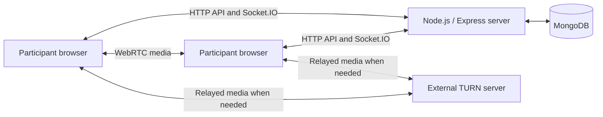

# PeerSpace

**A collaborative study platform where people can meet, talk, share their screen, and focus together in real time.**

[Open the live app](https://peerspace-d95c.onrender.com)

PeerSpace brings a study group's video call, messages, and shared countdown into one room. A host creates a room and invites others using a room ID or invite link. Participants can join with their accounts, switch their microphone and camera independently, and request permission to present their screen.

## Features

- **Accounts and authentication:** registration, login, logout, and protected rooms. Joining requires an account; there is no guest mode.
- **Study rooms:** create a room and enter it automatically, join by ID or invite link, and leave when finished.
- **Live presence:** participant lists update as people join, leave, or disconnect. Offline participants are hidden from the media gallery.
- **Audio and video:** independent microphone and camera controls, speaking indicators, and a responsive, paginated participant gallery with avatars for camera-off users.
- **Screen sharing:** participants request host approval. Shared screens have their own tiles and can expand into a presentation layout or fill the website viewport.
- **Room chat:** persistent message history and live messages for room members.
- **Shared study timer:** the host chooses a duration, then starts, pauses, resumes, or resets a countdown synchronized across the room.
- **Host controls:** transfer ownership, remove participants, approve screen sharing, and end a room for everyone.

## How to use it

1. Open the live app and register or log in.
2. Create a study room, or join one using its ID or invite link.
3. Turn on your microphone or camera when needed and allow the browser's device permissions.
4. Use chat and the shared timer during your study session. Request screen sharing when you want to present.
5. Leave the room when finished. The host can end the room for everyone.

## Tech stack

| Area | Technologies | Purpose |
| --- | --- | --- |
| Frontend | React, JavaScript, Vite | Interactive pages and development/build tooling |
| UI and routing | Tailwind CSS, React Router | Responsive styling and page navigation |
| API client | Axios | Requests between the frontend and backend |
| Backend | Node.js, Express | Authentication, room APIs, and production frontend serving |
| Database | MongoDB, Mongoose | Store users, rooms, timer state, and chat messages |
| Authentication | JWT, bcryptjs, HTTP-only cookies | Signed sessions and hashed passwords |
| Real-time events | Socket.IO | Presence, chat updates, timer updates, and call signaling |
| Calls and screen sharing | WebRTC, STUN/TURN | Browser-to-browser media and relay connectivity |
| Packaging and hosting | Docker, Docker Compose, Render | One-container deployment of the application |
| Checks | Node.js test runner, ESLint, Chrome browser tests | Backend, frontend, and media verification |

## How it works

The React frontend calls Express APIs for authentication and room actions. MongoDB stores persistent data, while Socket.IO delivers live room updates and exchanges the connection information needed to establish WebRTC calls.

**Socket.IO does not carry the audio or video.** WebRTC sends media between participants directly when possible, or through a TURN relay when a direct connection cannot be established.



In production, Express also serves the built React frontend. The application runs in **one Docker container**; MongoDB and TURN are external services.

## Run locally

### Prerequisites

- Git to clone the repository.
- MongoDB Atlas or another reachable MongoDB database.
- TURN credentials for call configuration and connectivity across networks.
- Docker Desktop using Linux containers for the Docker setup.
- Node.js 22.12+ and npm for development without Docker. The Docker image supplies its own Node runtime.

Clone the project:

```sh
git clone https://github.com/Kanakchauhan9822/PeerSpace.git
cd PeerSpace
```

Copy [Backend/.env.example](Backend/.env.example) to `Backend/.env` and fill in your own values. Keep an existing `.env` if you already have one. Never commit credentials.

Generate a random JWT secret with Node, if installed:

```sh
node -e "console.log(require('node:crypto').randomBytes(32).toString('hex'))"
```

### Option 1: Docker

Set `CLIENT_ORIGIN=http://localhost:3000` in `Backend/.env`, then run from the repository root:

```sh
docker compose up --build
```

Open **http://localhost:3000**. No separate Vite process is needed.

| Command | What it does |
| --- | --- |
| `docker compose up -d --build` | Build and start in the background |
| `docker compose ps` | Show container status and health |
| `docker compose logs -f` | Follow application logs |
| `docker compose down` | Stop and remove the Compose container |

Run the build command again after changing code. Compose uses port `3000`; stop any other application using it first. To use another local port, change the left side of the Compose port mapping, such as `8080:3000`, and update `CLIENT_ORIGIN` to match.

### Option 2: Development without Docker

Set `CLIENT_ORIGIN=http://localhost:5173` in `Backend/.env`, keep `PORT=3000`, and leave `NODE_ENV` unset.

From the repository root, install dependencies:

```sh
npm --prefix Backend ci
npm --prefix Frontend ci
```

Start the backend in one terminal:

```sh
npm --prefix Backend run dev
```

Start the frontend in another terminal:

```sh
npm --prefix Frontend run dev
```

Open **http://localhost:5173**. Vite proxies `/api` and `/socket.io` requests to the backend on port `3000`. Nodemon restarts the backend when its files change.

## Environment variables

| Variable | Purpose |
| --- | --- |
| `MONGO_URI` | MongoDB connection string. Atlas network access must allow the application server. |
| `JWT_SECRET` | Long, randomly generated signing secret. |
| `CLIENT_ORIGIN` | Exact website origin without a trailing slash. Use `http://localhost:3000` for Docker, `http://localhost:5173` for Vite, or the deployed HTTPS origin. |
| `PORT` | Backend port, default `3000`. Compose sets this to `3000`. |
| `TURN_URL` | TURN URL supplied by your provider, including its port and transport if specified. |
| `TURN_USERNAME` | TURN username supplied by your provider. |
| `TURN_PASSWORD` | TURN credential supplied by your provider. |
| `NODE_ENV` | `production` enables frontend static serving and secure cookies. Docker sets this automatically. |
| `TRUST_PROXY` | Optional trusted proxy hop count or addresses. Configure only after verifying the hosting proxy topology; leave unset locally. |

Environment files are excluded from Git and Docker's build context. Supply secrets at runtime rather than placing them in the Dockerfile or frontend source. Authorized call participants receive the ICE configuration needed by their browsers.

## Tests and checks

After installing dependencies, run these commands from the repository root:

```sh
npm --prefix Backend test
npm --prefix Frontend run lint
npm --prefix Frontend run build
npm --prefix Frontend run test:screen
npm --prefix Frontend run test:chat
node --test Frontend/tests/gallery.test.mjs
```

The browser suites require Chrome. The runner defaults to the standard Windows Chrome installation path; set `CHROME_PATH` if Chrome is installed elsewhere.

An optional backend integration suite exercises the API and live events against MongoDB:

```sh
npm --prefix Backend run test:chat:integration
```

Set `CHAT_TEST_MONGO_URI` to an **isolated test database** before running this suite. Never use the production database.

Automated media tests use synthetic streams. Also test with two real users on different networks: authentication, room joining, camera-off audio, screen-share approval, timer updates, and reconnection after network loss. Browser autoplay permissions and a provider's live TURN connectivity require real-world checks.

## Deployment

The public application is hosted on Render at **https://peerspace-d95c.onrender.com**.

To deploy your own copy, use a Docker web service with the repository-root `Dockerfile`, supply the environment variables above, and set `CLIENT_ORIGIN` to your own HTTPS URL. The host must support a long-running Node server and WebSocket upgrades. Configure the health-check path as `/health` and allow at least 10 seconds for graceful shutdown.

Camera and microphone access require HTTPS outside localhost. Production authentication cookies use the `Secure` flag. Hosting sleep behavior, resource limits, and TURN quotas depend on your provider and plan.

The `/health` endpoint returns `200` when MongoDB is connected and the application is not shutting down, otherwise `503`. Docker checks it every 30 seconds; an unhealthy status does not itself restart the container. Shutdown disconnects sockets, closes HTTP connections and MongoDB, and has an 8-second deadline.

## Security

- Passwords are hashed with bcrypt. Registration requires at least 8 characters and at most 72 UTF-8 bytes. Usernames allow up to 50 characters, emails 254, and room names 100.
- Room operations require authentication and appropriate membership or host permissions.
- Authentication requests are limited by client IP: 10 registrations and 30 login attempts per 15 minutes. Room creation permits 10 requests per minute per user, and joining permits 30.
- Socket events are limited to 120 non-ICE events and 600 ICE events per user per minute. HTTP rate-limit responses return `429` with `Retry-After`.
- API writes and browser socket handshakes validate the configured origin. Clients without an `Origin` header must still satisfy route authentication. JSON bodies are limited to 32 KB and socket messages to 128 KB.
- Private API responses are not cached. Socket sessions disconnect at token expiry, and logout disconnects sockets associated with that login token.

Do not blindly trust forwarded proxy headers: an incorrect `TRUST_PROXY` setting can let clients bypass IP-based limits.
